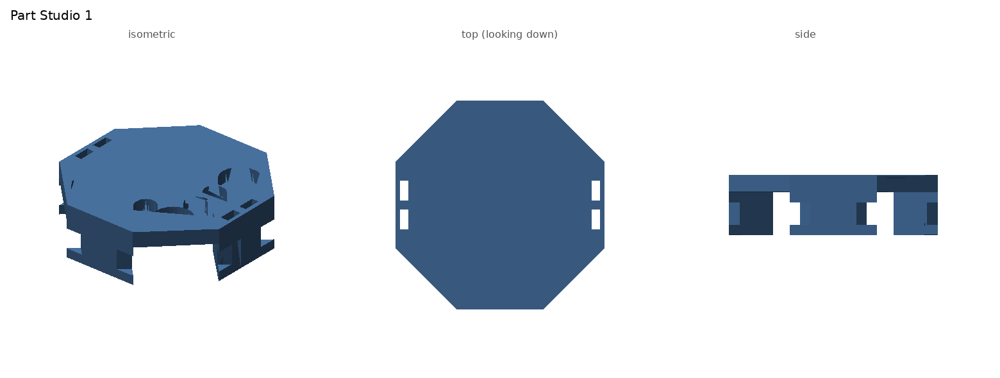
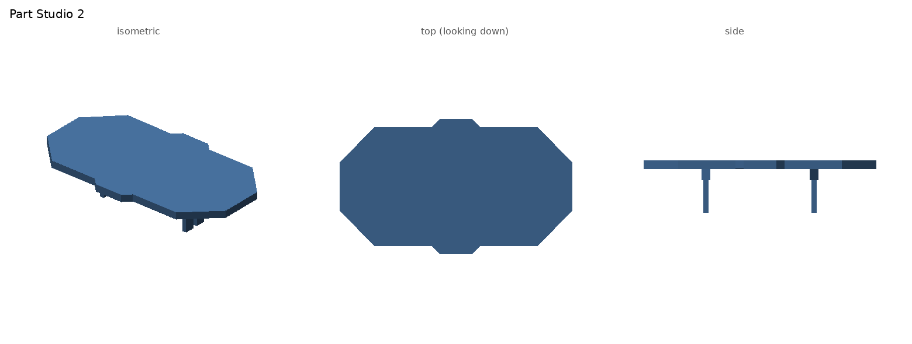
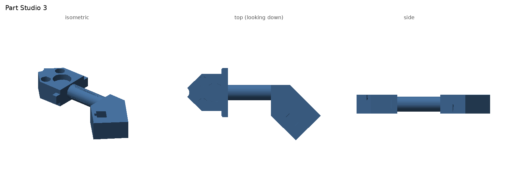
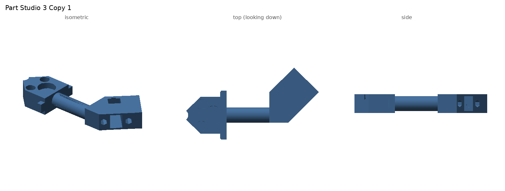
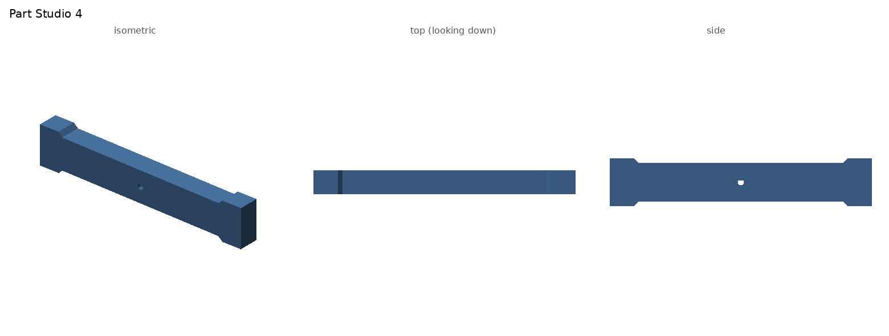
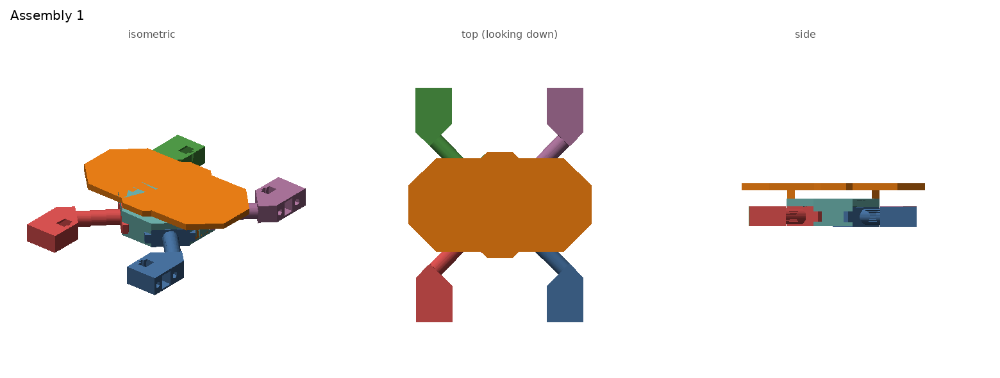

# Onshapefile — CAD for the robot dog

These are the STEP files exported from our Onshape document. They are numbered in build order:
the body comes first, then the legs, then the full assembly. Every dimension is in **millimetres**.
The measurements below come from the STEP geometry itself, so they match what Onshape exported.

| # | File | What it is | Qty to print |
|---|------|------------|--------------|
| 01 | `01_Part_Studio_1_Hub.step` | Central hub (the body core the legs snap onto) | 1 |
| 02 | `02_Part_Studio_2_Top_Platform.step` | Top deck (holds the ESP32 + battery) | 1 |
| 03 | `03_Part_Studio_3_Leg_Arm.step` | Detachable leg arm with N20 motor bay | 2 |
| 04 | `04_Part_Studio_3_Copy_1_Leg_Arm_Loose_Fit.step` | Same leg arm with slightly looser magnet pockets | 2 |
| 05 | `05_Part_Studio_4_Leg_Spoke.step` | Rotating leg spoke (wheg) on the N20 shaft | 4 |
| 06 | `06_Assembly_1_Full_Body.step` | Everything mated together (no spokes yet) | — |

Each part has a rendered preview in `previews/` showing isometric, top and side views.

**How it fits together:** the hub sits in the middle and the top platform plugs onto it with
four pegs. Four leg arms slide into the hub on the 45° diagonals, where magnets hold them in place.
Each arm carries an N20 gearmotor at its outer end, and a spoke on the motor shaft is what touches
the ground. Because the magnets are the only thing holding a leg on, a leg can come off, which the
stuck-leg software relies on. The software only allows two legs off at once if they are a
diagonal pair (FL+RR or FR+RL), and that pairing matches the diagonal layout here.

---

## 01 — Part Studio 1: Central Hub

**Purpose:** this is the structural core. All four legs and the top platform attach to it.

- **Overall size:** an octagon 72.4 mm across the flats and 21 mm tall.
  It prints as one solid of about 32.4 cm³.
- **Top plate:** 6 mm thick, with the octagon outline.
- **Leg magnet pockets (×4):** one at each diagonal corner, on the underside of the plate.
  - One large round pocket per corner, Ø15.15 mm and 5.1 mm deep, for the main disc magnet.
  - Two small pockets beside it, each Ø8.2 mm, for smaller alignment magnets.
  - These line up face to face with the matching pockets on top of each leg arm (part 03/04).
    That way each leg is held by three magnets, which keeps it from twisting.
  - Fit: put a dab of CA glue in each pocket and press the magnet in. Check the polarity against
    an arm before the glue sets.
- **Central boss:** a Ø10 mm cylinder hanging 15 mm down from the plate. Each arm's concave
  R5 tip seats against this boss, which stops the arms sliding inward and centres all four.
- **Wall blocks (×4):** blocks under the plate on the four flat sides.
  - Each block has 8 mm wide side grooves, and each arm's 2 mm flange slides into them
    (like a drawer runner).
  - The open gaps between blocks sit at the diagonals, and that is where the arms enter.
- **Peg slots:** rectangular slots in the top that take the four pegs of the top platform (part 02).

**Printing tip:** print it top-plate-down so the magnet pockets come out clean. The boss and
wall blocks then point up, and no supports are needed.

---

## 02 — Part Studio 2: Top Platform

**Purpose:** a deck for the electronics (ESP32 board, battery and wiring). It also covers the hub.

- **Overall size:** a plate 142.4 × 82.4 mm and 5 mm thick, with chamfered corners and centre tabs.
  Total height including the pegs is 32 mm, and the volume is about 52.4 cm³.
- **Ribs (×2):** 5.1 mm wide and 7 mm tall, running under the plate. They stiffen the long span
  so the deck doesn't sag under the battery.
- **Pegs (×4):** 2.8 × 6.8 mm rectangular posts, 20 mm long, that drop into the hub's peg slots.
  - The rectangular shape means the deck can't rotate on the hub.
  - It is a friction fit, so the deck pulls off for battery swaps.
  - If the pegs are too tight after printing, sand them lightly. If they are too loose,
    add a wrap of tape.
- The deck sits about 11 mm above the hub (see the assembly side view). That leaves room under
  it to run motor wires from the arms to the ESP32.

---

## 03 — Part Studio 3: Leg Arm (×2)

**Purpose:** the detachable leg. It snaps into the hub with magnets and carries the drive motor.

- **Overall size:** 106.9 mm long, 15 mm thick and 58 mm wide at the angled motor end.
  The volume is about 24.8 cm³.
- The arm has three sections, described from the hub end outward.
  1. **Inner block (hub end).**
     - Magnet pockets on top: one Ø15.15 mm and two Ø8.15 mm, all 5 mm deep. These mirror the
       hub's pockets exactly.
     - **Concave R5 tip** that wraps around the hub's Ø10 mm boss.
     - **Flange:** a 2 mm thick plate, 39.3 mm wide and 7.8 mm tall, that slides into the
       hub's side grooves. It sets the arm's height and keeps it from rocking.
  2. **Tube.** A round section with Ø12 mm outside and Ø10 mm bore, running from x = 21 to 56 mm.
     - The bore is closed at both ends, so it is a hollow beam. It saves plastic and weight while
       staying stiff.
     - It is not a wire channel as modelled. Run the motor wires along the outside, or drill
       the ends open if you want them inside.
  3. **Motor block (outer end).** This section is turned 45° from the tube, so the leg points
     forward or backward like a dog's leg rather than straight out sideways.
     - It contains a closed **motor pocket about 10.2 × 12.2 × 24.4 mm**. That is the
       cross-section of an **N20 gearmotor** (10 × 12 mm body, about 24 mm for gearbox plus motor)
       with roughly 0.2 mm clearance.
     - Small rectangular openings in the side walls let the D-shaft and the motor's solder tabs
       come out.
     - There is a slot on top for pressing the motor in and routing its wires.
- **How it attaches:** slide the flange into the hub grooves, push until the R5 tip hits the boss,
  and the magnets click together. To detach, pull outward. The magnet pull is the only thing that
  resists, which is exactly what the "detach leg" feature needs.

---

## 04 — Part Studio 3 Copy 1: Leg Arm, looser fit (×2)

**Purpose:** the same arm as part 03, kept as a fit test or tolerance variant.

- Same overall geometry as part 03: inner block, tube and 45° motor block.
- The magnet pockets are slightly bigger: **Ø15.2 / Ø8.2 mm and 5.2 mm deep**, instead of
  15.15 / 8.15 mm and 5.0 mm deep.
  - That is about 0.05 mm more diameter and 0.2 mm more depth, so magnets drop in easier on
    printers that over-extrude.
  - The extra depth means the magnet can sit flush or slightly recessed, so the arm and hub faces
    meet fully.
- In the assembly, two of the arms come from part 03 and two from this copy.
  - **If one version's magnets fit your printer better, print all four from that file.**
  - Functionally they are identical.

---

## 05 — Part Studio 4: Leg Spoke / Wheg (×4)

**Purpose:** the part that actually touches the ground. The N20 spins it, and its two ends act
as feet. This is the "wheel-leg" (wheg) style of walking.

- **Overall size:** a 110 × 20 × 10 mm dogbone. The two ends are 20 mm wide pads and the middle
  narrows to 16 mm.
- **Centre D-hole:** about Ø2.8 mm with one flat, sized to press onto the N20's 3 mm D-shaft.
  - The flat transmits the torque so the spoke doesn't slip.
  - Print it slightly undersized, as here, so it press-fits. If it is too tight, ream it with a
    3 mm drill. If it slips, add a drop of CA glue.
- Each foot sweeps a 55 mm radius circle. The robot walks by rotating the spokes. A common gait
  runs diagonal legs in phase, which is the same diagonal pairing the software uses.
- **Not placed in Assembly 1 yet.** It mounts on each motor shaft sticking out of the
  arm's motor block.

---

## 06 — Assembly 1: Full Body

**Purpose:** shows every part in its final position, and is used to check for interference
before printing.

- **Contents:** 1 × hub (01), 1 × top platform (02), 2 × leg arm (03) and 2 × leg arm copy (04).
  The arms sit on the four 45° diagonals: FL, FR, RL and RR.
- **Overall footprint:** about 142 × 183 mm and 33 mm tall, without spokes.
- **Mates you can see:**
  - The arm magnet pockets sit directly under the hub's magnet pockets, face to face.
  - The arm R5 tips touch the hub boss.
  - The arm flanges sit in the hub grooves.
  - The platform pegs sit in the hub's slots, and the deck rides above the hub.
- **Leg naming** (matches the code in `stuck-leg/common.py`): FL = front-left, FR = front-right,
  RL = rear-left, RR = rear-right.
  - Diagonal pairs that may both detach: **FL+RR** and **FR+RL**.
- **Still to do:** add four of part 05 onto the motor shafts, and an ESP32/battery mock-up on
  the deck.

---

## Bill of materials (from the CAD)

| Item | Qty | Notes |
|------|-----|-------|
| Printed hub (01) | 1 | |
| Printed top platform (02) | 1 | |
| Printed leg arm (03 or 04) | 4 | any mix |
| Printed leg spoke (05) | 4 | |
| Disc magnet Ø15 mm, ≤5 mm thick | 8 | 4 in hub + 4 in arms, check polarity |
| Disc magnet Ø8 mm, ≤5 mm thick | 16 | 8 in hub + 8 in arms |
| N20 gearmotor, 3 mm D-shaft | 4 | press into arm motor pocket |
| ESP32 dev board + battery | 1 | on the top platform |

## Opening the files

- **Onshape:** go to Create → Import, then pick the `.step` file (Assembly 1 imports as
  an assembly).
- **Fusion 360 / FreeCAD / SolidWorks:** File → Open, then choose the `.step` file.
- **Slicer (Cura / PrusaSlicer / Bambu):** these need STL. In Onshape, right-click the part
  and choose Export → STL.
